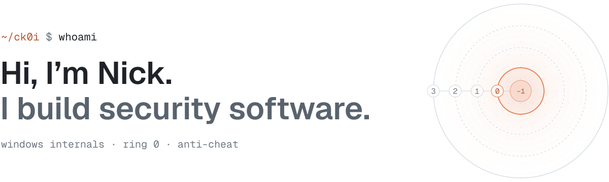

<a href="https://ckoi.dev">
  <picture>
    <source media="(prefers-color-scheme: dark)" srcset="assets/banner-dark.svg">
    
  </picture>
</a>

 

I'm Nick, known online as **koi**. I work on anti-cheat compatibility with EA's Javelin team, and spend the rest of my time in kernel drivers, hypervisors, and figuring out how detection systems think.

### Research

**[Kinematic features are all you need](https://ckoi.dev/research)** 2026  
Can software tell a human hand from generated mouse input? My detector catches over 99.5% of generated movements at under 0.1% false positives, and keeps holding up against a white-box attacker.  
[Paper](https://ckoi.dev/papers/kinematic-features-are-all-you-need.pdf) · [Zenodo](https://zenodo.org/records/18872499) · [Detector source](https://github.com/ck0i/sigmadrift-detector)

### Selected writing

- [IMDUI: an immediate-mode C++ UI framework for Windows](https://ckoi.dev/blog/imdui-why-we-built-our-own-ui-framework) Sep 2026
- [Argus: kernel memory disclosure through Defender's KSLD process gate](https://ckoi.dev/blog/argus-kernel-memory-disclosure-through-defenders-ksld-process-gate) May 2026
- [Disarming Windows Code Integrity through unprotected .data globals](https://ckoi.dev/blog/ci-dll-unsigned-driver-loading) Mar 2026
- [Why anti-cheats walk your call stack](https://ckoi.dev/blog/why-anti-cheats-walk-your-call-stack) Jan 2026

[More writing on ckoi.dev →](https://ckoi.dev/blog)

### Toolbox

`C++` `C` `Rust` `x86/x64 asm` `Python` `HLSL`  
Kernel drivers · reverse engineering · anti-cheat · hypervisors · DirectX

 

  <a href="https://ckoi.dev">ckoi.dev</a> · <a href="https://ckoi.dev/research">Research</a> · <a href="https://ckoi.dev/blog">Writing</a> · <a href="mailto:helzky@proton.me">helzky@proton.me</a>

